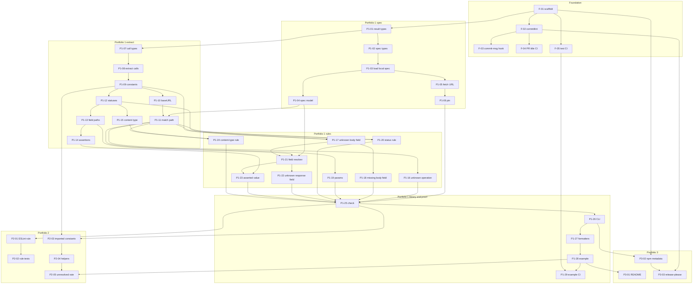

# Auditor architecture

Auditor is a static checker. It reads an OpenAPI 3.x document and existing Playwright API test files, and reports places the tests disagree with the spec. It does not run Playwright, does not start a browser, and does not call the API under test.

Fetching the spec from a URL is allowed. That fetch is the only network call. It requires a host allowlist, takes an auth header from the caller, and can save a pinned copy. A call the extractor cannot resolve is recorded as unresolved. The engine never invents a method, URL, body, or expectation.

The checking engine is a library. The CLI is a thin wrapper. An ESLint rule, later, calls the same `check` function. `src/index.ts` and everything it imports must not import the CLI.

Normative behavior lives in this document. Task-level inputs, outputs, and acceptance commands live in `docs/backlog.md`. Where a product choice was not fixed by the backlog, the task implements the recommended default and the choice is listed under Open questions in the backlog. Change the question, this document, and the task together before starting that task.

## Repository starting point

Inspected before this refinement (21 Oct 2026):

- Git remote `github.com/tuyenluong/auditor`. The only branch is `main`, at commit `48e129e` ("Initial commit"). Working tree was clean. No pull requests and no product source.
- Tracked files are `README.md` (contents `# auditor`), `LICENSE` (Apache-2.0), and `.gitignore` (the GitHub Visual Studio template). There is no `package.json`, no `src/`, and no `.github/workflows`.
- An earlier Cloud Agent, "Set up auditor environment" (`bc-d6504c22-7463-44c6-9dae-2a3535996783`), built the environment because the repo had nothing to install or start. Its install script checks that `README.md` and `LICENSE` exist, then prints `auditor: checkout present; no dependencies to install`. The start script is empty. `environment.json` is not committed (personal environment).
- Draft build `bld-20261021-162009a2-ef2e-4e8d-be8d-4fe69f692728` succeeded. This run booted from that snapshot: Node v22.23.3, Python 3.12.3, git 2.43.0. A later recurring environment build was still in progress at the time of writing. It does not change the product.
- Task `F-01` replaces the Visual Studio `.gitignore` with a Node ignore file. Product CI is the GitHub Actions workflows in `F-05` and `P1-29`, not the Cloud Agent install script.

The unscoped npm name `auditor` is already published (`auditor@0.1.4`, last updated 2022-06-13). The package name default is `@tuyenluong/auditor`. The CLI binary is still `auditor`. See OQ-1.

## Module layout

npm workspaces, one publishable package until the ESLint plugin:

```
package.json                          private workspace root
package-lock.json
commitlint.config.mjs                 F-02
.githooks/commit-msg                  F-03
scripts/lint-pr-title.mjs             F-04
scripts/check-release-workflows.mjs   P3-03
CONTRIBUTING.md
docs/architecture.md
docs/backlog.md
docs/releasing.md                     P3-03
docs/unresolved-baseline.md           P2-05
.github/workflows/pr-title.yml        F-04
.github/workflows/ci.yml              F-05, extended by P1-29
.github/workflows/release-please.yml  P3-03
.github/workflows/npm-publish.yml     P3-03, workflow_dispatch only
release-please-config.json            P3-03
.release-please-manifest.json         P3-03
packages/auditor/
  package.json                        name @tuyenluong/auditor, version 0.0.0
  tsconfig.json
  tsconfig.build.json
  vitest.config.ts
  src/index.ts                        public exports only
  src/types.ts                        Finding, UnresolvedCall, CheckResult, RuleId
  src/errors.ts                       AuditorError
  src/spec/load.ts                    file, URL, and pin entry
  src/spec/fetch.ts                   allowlist, auth header, redirects, limits
  src/spec/parse.ts                   swagger-parser wrapper
  src/spec/model.ts                   dereferenced document to SpecModel
  src/spec/pin.ts                     raw bytes plus sidecar
  src/playwright/extract.ts           request calls inside test()
  src/playwright/constants.ts         same-file literals
  src/playwright/config.ts            playwright.config baseURL
  src/playwright/expectations.ts      status, fields, assertions, content type
  src/playwright/match.ts             method plus path template
  src/playwright/model.ts             ExtractedCall
  src/schema/fields.ts                properties, required, locate, suggest
  src/rules/runner.ts
  src/rules/unknown-operation.ts
  src/rules/unknown-body-field.ts
  src/rules/missing-required-body-field.ts
  src/rules/params.ts
  src/rules/undocumented-status.ts
  src/rules/unknown-response-field.ts
  src/rules/asserted-value.ts
  src/rules/content-type.ts
  src/cli/main.ts                     bin entry, not imported by the library
  src/cli/args.ts
  src/cli/format-text.ts
  src/cli/format-json.ts
  test/                               vitest, mirrors src
examples/orders/                      P1-28, real Playwright tests, not executed
packages/eslint-plugin/               P2-01 only, not created in slice one
```

`packages/auditor/src/index.ts` exports `check`, `AuditorError`, and the types in the next section. It does not export CLI functions.

## Dependencies

| Concern | Choice | Why |
| --- | --- | --- |
| OpenAPI parse and `$ref` | `@apidevtools/swagger-parser` `^13.1.0` (peer `openapi-types` `>=7` installed directly) | It validates an OpenAPI document and dereferences `$ref`s in one call. 3.1 support has been in the library since 10.1, and 13.1.0 accepts OpenAPI 3.1.2. It requires Node `>=22.19.0`, which this environment already has (v22.23.3). |
| TypeScript and JavaScript AST | `typescript` `^7.0.2`, `ts.createSourceFile` | The repo is TypeScript, so one parser covers `.ts` and `.js` and reports the line and column the findings use. The core library does not take a dependency on ESLint's parser. 7.0.2 is the current stable release. |
| Test runner | `vitest` | Runs TypeScript tests without a separate compile step. |
| CLI parsing | `node:util` `parseArgs` | The flag set is small and Node 22 provides it, so the CLI adds no parser dependency. |
| HTTP | global `fetch` | Node 22 provides it. No `node-fetch`. |
| Glob | `fs.promises.glob` | Node 22 provides it. The library itself receives an explicit file list. |
| Commit messages | `@commitlint/cli` and `@commitlint/config-conventional` `^21.2.4`, plus `@commitlint/lint` and `@commitlint/load` at the same version | The client's convention is Conventional Commits, and this preset enforces it. Commitlint 21 is ESM and requires Node `>=22.12.0`. |
| Versioning | `googleapis/release-please-action@v4` with a manifest config | It reads Conventional Commits, opens a release PR, and writes `CHANGELOG.md`. Publishing is a separate manually approved workflow. |
| Fuzzy hint | in-tree Levenshtein in `src/schema/fields.ts` | The hint is a single comparison against sibling property names. A library would be larger than the function. |

The library's runtime dependencies are `@apidevtools/swagger-parser` and `openapi-types`. `typescript` is a devDependency used by the extractor at runtime of the tool, so it is a runtime dependency of `@tuyenluong/auditor` as well (users run the checker; they do not embed it in a browser). `@playwright/test` is a devDependency used only to typecheck `examples/orders`. The library source must not import it.

## Core types

These shapes are the contract. Names are exact. Fields marked optional may be omitted. Do not add a required field without a `BREAKING CHANGE` commit.

```ts
export type HttpMethod =
  | "get" | "post" | "put" | "patch" | "delete" | "head" | "options" | "trace";

export type RuleId =
  | "auditor/unknown-operation"
  | "auditor/unknown-body-field"
  | "auditor/missing-required-body-field"
  | "auditor/unknown-param"
  | "auditor/missing-required-param"
  | "auditor/undocumented-status"
  | "auditor/unknown-response-field"
  | "auditor/asserted-value"
  | "auditor/content-type";

export type Severity = "error" | "warning";

export interface Finding {
  file: string;
  line: number;       // 1-based
  column: number;     // 1-based, ts.getLineAndCharacterOfPosition column + 1
  ruleId: RuleId;
  message: string;
  severity: Severity;
  suggestion?: string; // schema spelling, when the message has a "Did you mean" hint
}

export type UnresolvedReason =
  | "non-literal-url"
  | "non-literal-method"
  | "non-literal-data"
  | "non-literal-param"
  | "non-literal-header"
  | "helper-call"
  | "imported-value"
  | "spread"
  | "computed-key"
  | "ambiguous-constant"
  | "reassigned-response"
  | "negative-ok"
  | "status-range"
  | "ambiguous-response-schema"
  | "ambiguous-content-type"
  | "raw-string-body"
  | "form-body"
  | "outside-test"
  | "ambiguous-path";

export interface UnresolvedCall {
  file: string;
  line: number;
  column: number;
  callee: string;          // e.g. "request.post" or "api.fetch"
  reason: UnresolvedReason;
  detail?: string;
}

export interface SpecParameter {
  name: string;
  in: "path" | "query" | "header" | "cookie";
  required: boolean;
  schema?: JsonSchema;
}

export interface JsonSchema {
  type?: string | string[];
  enum?: unknown[];
  properties?: Record<string, JsonSchema>;
  required?: string[];
  items?: JsonSchema;
  additionalProperties?: boolean | JsonSchema;
  oneOf?: JsonSchema[];
  anyOf?: JsonSchema[];
  allOf?: JsonSchema[];
  nullable?: boolean;
  format?: string;
}

export interface SpecOperation {
  method: HttpMethod;
  pathTemplate: string;    // "/orders/{id}"
  operationId?: string;
  parameters: SpecParameter[];
  requestBody?: {
    required: boolean;
    content: Record<string, JsonSchema>; // media type to schema
  };
  responses: Record<string, { content: Record<string, JsonSchema> }>;
}

export interface SpecModel {
  openapi: string;         // "3.0.3" or "3.1.0"
  title?: string;
  version?: string;        // info.version
  source: "file" | "live" | "pinned";
  location: string;
  operations: SpecOperation[];
  servers: string[];       // servers[].url values that are strings
}

export interface ExtractedCall {
  file: string;
  line: number;
  column: number;
  callee: string;
  method?: HttpMethod;     // omitted when the method did not resolve
  path?: string;           // stripped path, query removed; omitted when unresolved
  pathParams: Record<string, Literal | { unresolved: UnresolvedReason }>;
  query: Record<string, Literal | { unresolved: UnresolvedReason }>;
  headers: Record<string, Literal | { unresolved: UnresolvedReason }>;
  body?: JsonValue | { unresolved: UnresolvedReason };
  expectations: ResponseExpectation[];
  unresolved: UnresolvedCall[]; // parts of this call that were skipped
}

export type Literal = string | number | boolean | null;

export type JsonValue =
  | Literal
  | JsonValue[]
  | { [key: string]: JsonValue }
  | { spread: true };

export interface ResponseExpectation {
  responseVar: string;
  line: number;
  column: number;
  statuses: Array<number | "2xx">;
  contentTypes: string[];
  fields: JsonFieldAccess[];
  assertions: Assertion[];
}

export interface JsonFieldAccess {
  path: Array<string | number>; // ["items", 0, "sku"]
  line: number;
  column: number;
}

export interface Assertion {
  path: Array<string | number>;
  line: number;
  column: number;
  kind: "literal" | "type";
  literal?: Literal;
  typeName?: "string" | "number" | "boolean" | "object" | "array";
}

export interface CheckOptions {
  cwd?: string;
  baseURL?: string;
  playwrightConfigPath?: string | null; // null skips the config search
  allowHosts?: readonly string[];
  specAuthHeader?: string;              // already formatted; library does not read env
  pinPath?: string;
  savePinPath?: string;
  rules?: Partial<Record<RuleId, Severity | "off">>;
}

export interface TestFileInput {
  path: string;
  text?: string; // editor buffer; omit to read from disk
}

export interface CheckResult {
  spec: SpecModel;
  calls: ExtractedCall[];
  findings: Finding[];
  unresolved: UnresolvedCall[];
  summary: {
    checked: number;
    unresolved: number;
    partial: number;
    findings: number;
  };
}

export class AuditorError extends Error {
  readonly exitCode = 2 as const;
  readonly code:
    | "SPEC_NOT_FOUND"
    | "SPEC_INVALID"
    | "SPEC_FETCH"
    | "SPEC_PIN"
    | "NO_TESTS"
    | "CONFIG";
}
```

`Finding.severity` includes `"warning"` so a later optional rule can use it without a breaking type change. Every slice-one rule sets `"error"`. Exit code 1 is "any finding with severity error". A warning does not change the exit code. Slice one emits no warnings.

## Library API

```ts
export async function check(input: {
  spec: { location: string };
  testFiles: readonly TestFileInput[];
  options?: CheckOptions;
}): Promise<CheckResult>;
```

- `spec.location` is a filesystem path, an `https:` URL, or an `http:` URL whose host is `localhost` or `127.0.0.1`. Any other `http:` URL throws `AuditorError` `SPEC_FETCH`.
- The library does not read `process.env` and does not read `process.argv`. The CLI reads `AUDITOR_SPEC_TOKEN` (or the name passed to `--spec-auth-env`) and passes `specAuthHeader`.
- `testFiles` empty throws `NO_TESTS`.
- File paths in findings are relative to `options.cwd` (default `process.cwd()`) with posix separators when the file is inside that directory. Otherwise the path is absolute.
- Findings are sorted by file, line, column, then `ruleId`. The runner drops duplicates with the same file, line, column, `ruleId`, and message.
- `summary.checked` counts calls whose method and path both resolved. `summary.unresolved` counts calls whose method or path did not. A call is in exactly one of those two. `summary.partial` counts checked calls that also have at least one `UnresolvedCall`. `summary.findings` is `findings.length`.
- Unresolved records are notes. They are not findings and they do not by themselves change the exit code (OQ-3).

Request rules run only for checked calls, and only on the parts that resolved. A non-literal body produces `non-literal-data` (or a more specific reason) and skips body rules for that call. Response rules run only when that call has expectations. A request-only call produces no response findings.

## Spec loading

`@apidevtools/swagger-parser` `validate` both checks the document and dereferences `$ref`. The mapper reads the dereferenced object.

Accepted documents have an `openapi` string starting with `3.`. Swagger 2.0 (`swagger: "2.0"`) and missing or non-3.x `openapi` values throw `SPEC_INVALID` with message `Expected OpenAPI 3.x, found {value}`. A YAML or JSON syntax error throws `SPEC_INVALID` with message `Spec is not valid YAML or JSON: {parser message}`. A missing file throws `SPEC_NOT_FOUND` with message `Spec file not found: {path}`. Schema failures from swagger-parser throw `SPEC_INVALID` with message `Invalid OpenAPI: {first error}`.

`$ref` policy (OQ-9):

- Internal `#/...` refs are resolved.
- Relative file refs are resolved only when the real path stays inside the spec file's directory. A ref that escapes, including `../../../etc/passwd`, throws `SPEC_INVALID` and the target is not read.
- `http:` and `https:` refs are resolved only when the host is on `allowHosts`, using `specAuthHeader` when present. Any other external ref throws `SPEC_INVALID` with message `External $ref {ref} is not allowlisted`.
- Do not use the parser's default HTTP resolver. Supply a resolver that performs the host check before any request. Parser 12 and later already refuse internal URLs in the default resolver; the allowlist is still Auditor's rule.

`allOf` is merged into one object schema: union of `required`, intersection of `properties`. Conflicting `type` values throw `SPEC_INVALID`. For `oneOf` and `anyOf`, a property is known if any branch has it, required only if every branch requires it, and an assertion conflicts only if every branch conflicts.

Server URLs that are not strings are ignored. The remaining `servers[].url` values are stored on `SpecModel.servers`.

## URL fetch and pins

`src/spec/fetch.ts`:

- Exact host match against `allowHosts`, compared case-insensitively, port ignored. `api.example.com` does not allow `evil.api.example.com`. No wildcard entries in slice one.
- An empty allowlist refuses every remote spec with `SPEC_FETCH` and message `Host {host} is not allowlisted; pass --allow-host`. Local files do not need an allowlist.
- `https:` only, plus `http://127.0.0.1` and `http://localhost` so the unit test can use a local server.
- Redirects: at most 3, and only when the next host is allowlisted. A redirect off the list throws `SPEC_FETCH` and is not followed.
- Timeout 10 seconds. Response body cap 5 MiB. Over either limit throws `SPEC_FETCH`.
- When `specAuthHeader` is set, send it as the `Authorization` header. The CLI builds that value: if the env var already starts with `Bearer `, `Basic `, or `Token `, pass it unchanged; otherwise send `Bearer ${value}`. An unset env var means no `Authorization` header.

Pins:

- `--save-pin <path>` is valid only when `--spec` is a URL. The file written is the raw response bytes, not the dereferenced document. Sidecar `<path>.meta.json` contains `{ url, fetchedAt, sha256, openapi, version, title }`. This run's report source is `live`, because this run used the network.
- `--pin <path>` reads that file and does not open a socket. Report source is `pinned`. A missing pin throws `SPEC_PIN` with message `Pinned spec not found: {path}`. When both `--pin` and `--spec` are set, the pin wins.
- Text source words are exactly `file`, `live`, and `pinned`.

## Playwright extraction

Parse each test file with `ts.createSourceFile`. Script kinds: `.ts` and `.mts` and `.cts` are TypeScript; `.js`, `.mjs`, and `.cjs` are JavaScript. `.tsx` and `.jsx` are not parsed. The CLI skips them with one stderr line `skip jsx: {path}` and continues. If the glob matches no supported file, the CLI exits 2 with `No test files matched`.

A request call is recognized only when the receiver is one of:

1. A binding destructured from a `test`, `test.only`, `test.skip`, or `test.fixme` callback parameter, property name `request`, including a rename `{ request: api }`. `test` is either imported from `@playwright/test` or the free name `test`.
2. The value returned by `request.newContext()` where `request` is imported from `@playwright/test` (rename included).

Methods: `get`, `post`, `put`, `patch`, `delete`, `fetch`. For `fetch`, `options.method` must be a string literal or a same-file string constant. Omitted method means `GET`. A non-literal method records `non-literal-method` and the call is unresolved. `head`, `options`, and `trace` occur only through `fetch`.

Calls not inside a `test(...)` callback record `outside-test` and are unresolved. Module-scope helpers are not treated as checked calls.

The first argument is the URL. The optional second argument is an object. Read `params`, `headers`, and `data`. Ignore `timeout` and `failOnStatusCode`. `multipart` and `form` record `form-body` and skip body rules (OQ-7). A string `data` records `raw-string-body` and skips body rules. Playwright's `params` is the query string: an object literal, a same-file const, a query string literal (`a=1&b=2`), or `new URLSearchParams` with a literal or object of literals. Anything else is `non-literal-param` for the whole query.

Same-file constants, depth at most 10:

- Resolved: string, number, boolean, `null`, template with resolved expressions, object and array of resolved values, `+` of two resolved strings, parentheses, `as const`, and `satisfies`.
- Not resolved: call expressions (`helper-call`), imported bindings (`imported-value`), object spread (`spread`), computed keys (`computed-key`), ternaries and reassigned `let` (`ambiguous-constant`). A cycle is `ambiguous-constant`.

Cross-file imports stay `imported-value` until `P2-03`.

Query parameters also come from the URL's query string. They merge with `params`. A key in both, with different resolved values, records `ambiguous-constant` for that key.

### baseURL and servers

Search order for the Playwright config, unless `playwrightConfigPath` is set (`null` disables the search): `playwright.config.ts`, `.mts`, `.js`, `.mjs` in `cwd`.

Read `use.baseURL` from the default export. Unwrap a `defineConfig(...)` call whose callee is the local binding of `defineConfig` imported from `@playwright/test`. The same constant resolver applies. `process.env.SOMETHING` is not a literal: print one stderr line `playwright baseURL is not a literal; URLs were not rewritten.` and do not strip. Exit code is unchanged.

Strip order for a resolved URL:

1. Parse query into the call's query map and remove it from the path.
2. A path-absolute URL (`/orders`) is used as-is.
3. A relative URL (`orders`) is resolved against `baseURL` when `baseURL` is a literal, then stripped.
4. For an absolute URL, remove the first matching prefix among `baseURL` and `SpecModel.servers`, comparing origin plus base path with trailing slashes normalized.
5. If it is still absolute, remove only the origin.
6. The result must start with `/`. Decode each segment with `decodeURIComponent` before matching. A trailing slash does not change the match (`/orders/1/` and `/orders/1` are the same). `/` stays `/`.

### Path templates

Split the stripped path and the template on `/`, drop the leading empty segment, and drop one trailing empty segment. Static segments must be equal. A `{param}` segment matches one non-empty path segment. The expression name in `` `/orders/${orderId}` `` does not have to equal the spec parameter name. One expression matches one segment. `` `${a + b}` `` is `non-literal-url`. A fully literal template such as `` `/orders/${"1"}` `` or `` `/orders/${id}` `` with `const id = "1"` still matches `/orders/{id}`.

When the concrete path matches exactly one template, the call's path used in messages is that template (`/orders/{id}`), and each template parameter counts as present. When it matches more than one template, record `ambiguous-path` and emit no operation finding. When it matches none, the path used in the message is the stripped concrete path.

A matched path parameter is not also reported as a missing path parameter. Slice one does not check header or cookie parameters (OQ-8).

### Expectations

Inside the same `test()` callback, including nested `test.step` callbacks, link a response variable from `const res = await request.get(...)` or `let res = ...` with a single assignment. `await` is optional for the link. Two assignments to the same binding record `reassigned-response` and skip response rules for that variable. Request rules still run.

Collect every syntactic `expect` in the callback. Do not analyze reachability (OQ-14). `expect` is the import from `@playwright/test` or the free name `expect`.

Supported expectations:

| Shape | Result |
| --- | --- |
| `expect(res.status()).toBe(201)` or `toEqual(201)`, including a same-file numeric const | expected status 201 |
| `expect(res.ok()).toBe(true)`, `toEqual(true)`, or `toBeTruthy()` | expected status class `2xx` |
| `expect(res.ok()).toBe(false)` or `toBeFalsy()` | `negative-ok`, no status finding (OQ-5) |
| `expect(res.status()).toBeGreaterThan(...)` and other ranges | `status-range`, no status finding |
| `const body = await res.json()` then `body.id`, `body.items[0].sku` | field access. A computed index records `computed-key` for that access only |
| `expect(await res.json()).toMatchObject({ id: expect.any(String) })` and `toEqual` with the same shape | field reads plus assertions |
| `expect(body.status).toBe("shipped")`, `toEqual`, `toStrictEqual` with a literal | literal assertion |
| `expect.any(String\|Number\|Boolean\|Object\|Array)` | type assertion. `Number` is compatible with integer and number |
| `expect(res.headers()["content-type"]).toBe("application/json")` | content-type assertion, header name compared case-insensitively |

`toBeDefined`, `toBeTruthy` on a field, `toContain`, `toMatch`, and `expect.poll` do not produce assertions and do not produce findings.

## Rules and messages

All severities are `error`. `{METHOD}` is uppercase. Paths use the template when one matched, otherwise the stripped path.

| Rule | When | Message |
| --- | --- | --- |
| `auditor/unknown-operation` | No operation has this method and path. Path matched a template under other methods. | `No {METHOD} {template} in the spec. Spec allows {METHODS}.` |
| `auditor/unknown-operation` | No template matched. | `No {METHOD} {path} in the spec.` |
| `auditor/unknown-body-field` | A key is not a known property. See OQ-4. | `Body field "{dotted}" is not in the {mediaType} schema for {METHOD} {path}.` plus ` Did you mean "{suggestion}"?` when `suggestion` is set. |
| `auditor/missing-required-body-field` | A required key is absent. | `Required body field "{dotted}" is missing for {METHOD} {path}.` |
| `auditor/unknown-param` | Query key is not a query parameter of the operation. | `Unknown query parameter "{name}" for {METHOD} {path}.` plus the same hint sentence. |
| `auditor/missing-required-param` | A required query parameter is in neither the URL query nor `params`. | `Required query parameter "{name}" is missing for {METHOD} {path}.` |
| `auditor/undocumented-status` | Expected status is not documented and there is no `default` response. | `Expected status {code} is not documented for {METHOD} {path}. Documented statuses: {list}.` |
| `auditor/unknown-response-field` | Field path is not in the chosen response schema. | `Response field "{dotted}" is not in the {status} {mediaType} schema for {METHOD} {path}.` |
| `auditor/asserted-value` | Literal or `expect.any` conflicts with type or enum. | `Assertion {shown} conflicts with schema {type or enum} at "{dotted}" for {METHOD} {path}.` |
| `auditor/content-type` | Asserted media type is not documented for that status. | `Expected Content-Type "{value}" is not documented for status {status} on {METHOD} {path}. Documented: {list}.` |

Request body media type: the single `application/json` entry when it is the only JSON media type. If the request body has several content entries and none is `application/json`, record `ambiguous-content-type` and skip body rules. Nested object literals are checked. An array uses `items`. If a parent required property is missing, do not also report its children. An object spread records `spread` and skips missing-required checks for that object; explicit unknown keys on that object are still findings.

Unknown-field default (OQ-4): a key not listed in `properties` is a finding when `additionalProperties` is omitted or `false`. It is not a finding when `additionalProperties` is `true` or a schema.

Did-you-mean: classic Levenshtein on lowercased strings, threshold 2, candidates are sibling property names (or sibling query parameter names). A case-only difference (distance 0 after folding) suggests the schema spelling. One suggestion. A tie yields no suggestion and no hint sentence. The schema's original spelling is the suggestion.

Status matching: a concrete code matches that code, a documented range (`2XX` or `2xx`) that contains it, or a `default` response. `res.ok()` matches when any documented status is 200–299 or a `2xx` range. A `default` response suppresses `auditor/undocumented-status`.

Response schema choice: if the test names one status, use it. If the test expects `2xx` and exactly one documented 2xx response exists, use it. If several 2xx responses exist and their schemas differ, record `ambiguous-response-schema` and skip field and assertion rules (OQ-6). The status rule still passes. Content type: the asserted media type when the test has one, otherwise the only content entry, otherwise `application/json` when that entry exists, otherwise `ambiguous-content-type`. Media type comparison ignores parameters, so `application/json; charset=utf-8` matches `application/json`.

`toBe(1)` agrees with `integer` and `number`. `toBe(1.5)` conflicts with `integer`. `toBe("1")` conflicts with both. `toBe(null)` agrees when `nullable` is true or the 3.1 type array includes `null`. `expect.any(Number)` agrees with `integer` and `number`.

Point request findings at the call expression. Point response findings at the `expect` or the field access. Column is 1-based from the TypeScript position.

## CLI

```
auditor check --spec <file|url> --tests <glob> [--tests <glob>]...
  [--config <path>] [--format text|json] [--allow-host <host>]...
  [--spec-auth-env <NAME>] [--pin <path>] [--save-pin <path>]
```

`--spec-auth-env` defaults to `AUDITOR_SPEC_TOKEN`. `--format` defaults to `text`. `--tests` is repeatable and at least one is required. When `--spec` is a filesystem path, the CLI checks that the file exists before it expands globs, so a missing spec reports `Spec file not found:` even if the glob also matches nothing.

| Situation | Exit | Stream |
| --- | --- | --- |
| No error findings | 0 | report on stdout |
| One or more error findings | 1 | report on stdout |
| Usage, config, spec, fetch, pin, or no test files | 2 | message on stderr, no JSON report |
| `auditor --help`, `auditor check --help` | 0 | usage on stdout |
| `auditor` with no args, unknown flag | 2 | usage on stderr |

Unresolved calls do not change the exit code.

Text report, exact labels:

```
spec: Orders API 1.0.0 (file examples/orders/openapi.yaml, openapi 3.0.3)
checked: 13
unresolved: 1
partial: 0
findings: 14

examples/orders/tests/broken.spec.ts:18:3 auditor/unknown-operation No DELETE /orders/{id} in the spec. Spec allows GET.

unresolved:
examples/orders/tests/broken.spec.ts:40:3 helper-call request.post
```

Omit the finding block when `findings` is 0. Omit the `unresolved:` block when `unresolved` is 0. Keep the four count lines either way.

JSON report is 2-space JSON on stdout and nothing else:

```ts
interface JsonReport {
  spec: {
    title?: string;
    version?: string;
    openapi: string;
    source: "file" | "live" | "pinned";
    location: string;
  };
  summary: { checked: number; unresolved: number; partial: number; findings: number };
  findings: Finding[];
  unresolved: UnresolvedCall[];
}
```

`auditor check` writes the report only. No progress logs on stdout.

## Example contract

`examples/orders` is the slice-one proof. The tests typecheck with `@playwright/test` and CI does not execute them. `npm run example` typechecks them, runs Auditor on the clean suite (exit 0), and runs Auditor on the broken suite (exit 1), then exits 0 itself when those outcomes hold.

`examples/orders/playwright.config.ts` sets `use.baseURL` to `http://127.0.0.1:3000`. The spec `servers[0].url` is the same value. `examples/orders/openapi.yaml` is OpenAPI 3.0.3, title `Orders API`, version `1.0.0`, with `components.schemas.Order` (`id` string, `sku` string, `qty` integer, `status` enum `pending` | `shipped`, optional `note`) referenced by the responses.

| Method and path | Request | Responses |
| --- | --- | --- |
| `POST /orders` | JSON body, `additionalProperties: false`, required `sku` and `qty`, optional `note` | `201` `application/json` `Order` |
| `GET /orders` | required query `limit` integer | `200` `application/json` array of `Order` |
| `GET /orders/{id}` | path `id` required | `200` `application/json` `Order`, `404` with no content |

Clean suite, file `examples/orders/tests/clean.spec.ts`, zero findings and zero unresolved:

| Call | Expectation |
| --- | --- |
| `POST /orders` with `{ sku, qty }` | status 201, `expect.any(String)` on `body.id`, content type `application/json` |
| `GET` absolute `http://127.0.0.1:3000/orders?limit=1` | status 200, `body[0].status` literal `pending` |
| `` GET `/orders/${id}` `` with `const id = "1"` | status 200 |
| `GET /orders/1` | `res.ok()` |

Broken suite, file `examples/orders/tests/broken.spec.ts`. Expected summary: `checked: 13`, `unresolved: 1`, `partial: 0`, `findings: 14`. One call per row. `buildUrl` is `function buildUrl(): string { return "/orders"; }`.

| Call | Findings |
| --- | --- |
| `DELETE /orders/1` | `auditor/unknown-operation`, message names `DELETE` and `GET` |
| `POST /nope` | `auditor/unknown-operation` for `/nope` |
| `POST /orders` data `{ sku: "a", qtx: 1 }` | `auditor/unknown-body-field` for `qtx` with suggestion `qty`, and `auditor/missing-required-body-field` for `qty` |
| `POST /orders` data `{ qty: 1 }` | `auditor/missing-required-body-field` for `sku` |
| `GET /orders` with no params | `auditor/missing-required-param` for `limit` |
| `GET /orders` params `{ limit: 1, foo: "x" }` | `auditor/unknown-param` for `foo`, no suggestion |
| `GET /orders` params `{ limt: 1 }` | `auditor/unknown-param` for `limt` with suggestion `limit`, and `auditor/missing-required-param` for `limit` |
| `GET /orders/abc` expect status 418 | `auditor/undocumented-status` |
| `GET /orders/abc` expect 200, read `body.nope` | `auditor/unknown-response-field` for `nope` |
| `GET /orders/abc` expect 200, `body.status` `toBe("cancelled")` | `auditor/asserted-value` |
| `GET /orders/abc` expect 200, `body.qty` `toBe("1")` | `auditor/asserted-value` |
| `GET /orders/abc` expect 200, content type `text/plain` | `auditor/content-type` |
| `request.post(buildUrl())` | no findings, unresolved `helper-call` |
| `POST /orders` data `{ sku: "a", qty: 1 }` and no expects | no findings |

Rule ids in that table are the complete slice-one set. Each appears at least once.

## ESLint boundary

Slice two adds `packages/eslint-plugin` (package `@tuyenluong/eslint-plugin-auditor`, private until a later publish decision). The rule name is `auditor/request-matches-spec`. ESLint's `RuleTester` supplies the filename and source text. The rule calls `check` with `testFiles: [{ path, text }]` and a spec path from the rule option `spec`. It does not parse the test with a second copy of the extractor and it does not shell out to the CLI. Findings become ESLint messages with the same `ruleId` strings. Unresolved calls are not ESLint errors in the first version of the rule. They are reported as ESLint messages at severity `warn` only if the option `reportUnresolved: true` is set. Default is off.

## Release flow

Release Please and npm publish are separate workflows. Details of the files are the acceptance of `P3-03`. The shape:

1. Push to `main` runs `.github/workflows/release-please.yml` only. `googleapis/release-please-action@v4` reads `release-please-config.json` and `.release-please-manifest.json`, opens or updates a release PR, and on merge tags the repo and writes `packages/auditor/CHANGELOG.md`. This workflow has no `npm publish` step.
2. `.github/workflows/npm-publish.yml` runs only on `workflow_dispatch`. Its job sets `environment: npm`. A repository admin creates that GitHub environment with required reviewers and stores `NPM_TOKEN` there. The reviewers are the manual approval. The workflow is not triggered by `push`, `release`, or `workflow_run`.
3. Manifest version starts at `0.0.0`. `bump-minor-pre-major` and `bump-patch-for-minor-pre-major` are true, so the first `feat` release is `0.1.0` and a `feat!` before 1.0.0 bumps the minor (OQ-10).
4. Nobody runs `npm publish` as part of implementing the task, and this refinement does not publish.

`feat` is minor, `fix` is patch, and `docs`, `test`, `refactor`, `chore`, `ci`, `build`, and `perf` do not bump unless the commit carries `!` or a `BREAKING CHANGE` footer.

## Not supported in slice one

The README task copies this list.

- Running tests or calling the API under test.
- Resolving helpers and imports across files (slice two).
- Header and cookie parameters, and required header checks.
- `multipart` and `form` bodies.
- `expect(res.ok()).toBe(false)`, status ranges, and `expect.poll`.
- Reachability of `expect` inside conditionals.
- JSX test files.
- Wildcard allowlist hosts.
- Hurl, REST Assured, Postman, and other runners.
- A live mode that compares real responses.
- The optional "no response checks" rule (OQ-2). It stays off the schedule.

## Delivery order

Each row is one pull request. Commit subjects follow `CONTRIBUTING.md`. Land them in this order. A later row's dependencies are in earlier rows.

| PR | Tasks | Suggested title |
| --- | --- | --- |
| 1 | `F-01` | `build(repo): scaffold the typescript workspace` |
| 2 | `F-02`, `F-03`, `F-04` | `ci(repo): enforce conventional commits` |
| 3 | `F-05` | `ci(repo): run typecheck and unit tests` |
| 4 | `P1-01`, `P1-02` | `feat(repo): add result and spec types` |
| 5 | `P1-03` | `feat(spec): load a local OpenAPI file` |
| 6 | `P1-04` | `feat(spec): map operations into the spec model` |
| 7 | `P1-05` | `feat(spec): fetch a spec from an allowlisted URL` |
| 8 | `P1-06` | `feat(spec): pin a fetched spec` |
| 9 | `P1-07`, `P1-08` | `feat(playwright): extract literal request calls` |
| 10 | `P1-09` | `feat(playwright): resolve same-file constants` |
| 11 | `P1-10` | `feat(playwright): strip baseURL from request URLs` |
| 12 | `P1-11` | `feat(playwright): match calls to operations` |
| 13 | `P1-12` | `feat(playwright): extract expected statuses` |
| 14 | `P1-13` | `feat(playwright): extract response field paths` |
| 15 | `P1-14` | `feat(playwright): extract literal assertions` |
| 16 | `P1-15` | `feat(playwright): extract content-type assertions` |
| 17 | `P1-16` | `feat(rules): flag unknown operations` |
| 18 | `P1-17` | `feat(rules): flag unknown body fields` |
| 19 | `P1-18` | `feat(rules): flag missing required body fields` |
| 20 | `P1-19` | `feat(rules): flag query parameters` |
| 21 | `P1-20` | `feat(rules): flag undocumented statuses` |
| 22 | `P1-21`, `P1-22` | `feat(rules): flag unknown response fields` |
| 23 | `P1-23` | `feat(rules): flag asserted types and enums` |
| 24 | `P1-24` | `feat(rules): flag content types` |
| 25 | `P1-25` | `feat(repo): add the check library entry` |
| 26 | `P1-26` | `feat(cli): add the check command` |
| 27 | `P1-27` | `feat(cli): add text and json formatters` |
| 28 | `P1-28` | `feat(examples): add the orders clean and broken suites` |
| 29 | `P1-29` | `ci(examples): run the orders example in CI` |
| 30 | `P3-01` | `docs(repo): document install, usage, and limits` |
| 31 | `P3-02` | `build(release): add npm package metadata` |
| 32 | `P3-03` | `ci(release): draft the release-please workflow` |
| 33 | `P2-01`, `P2-02` | `feat(eslint): add auditor/request-matches-spec` |
| 34 | `P2-03` | `feat(playwright): resolve imported constants` |
| 35 | `P2-04` | `feat(playwright): resolve one-level helpers` |
| 36 | `P2-05` | `test(playwright): record the unresolved rate` |

Slice two (`P2-*`) stays after the release draft on purpose. The approved backlog ships slice one, then decides on slice two from real use. The ESLint rule is first inside slice two, which this order keeps.

## Dependency graph

An arrow means the source task lands before the target task. Grouping matches the portfolios. The pull request table above is one valid topological order, with some independent tasks sharing a PR.


